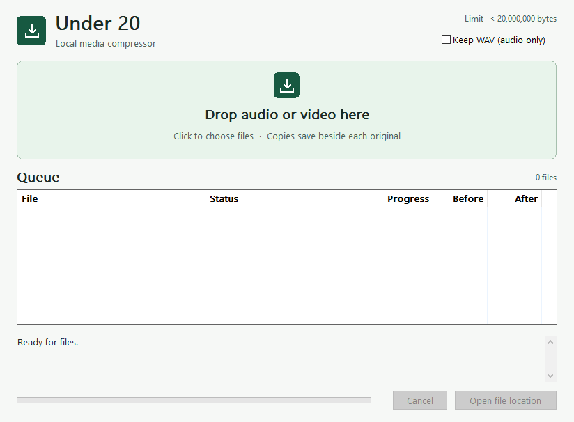
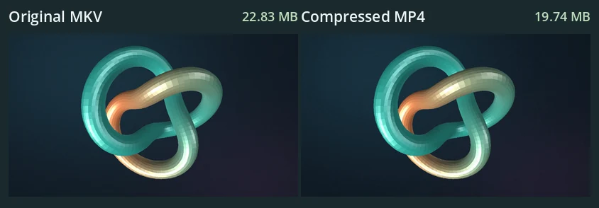

#  Under 20

Drop audio or video onto Under 20. It saves a copy **under 20 MB** beside each original, ready to attach or share.

**[Download for Windows x64 · 551 KB ZIP](https://github.com/tobiko-dev/media-under-20mb/releases/download/v1.0.0/Under20-Windows.zip)**

Extract the ZIP, open `Under20.exe`, and drop in your files. It uses your installed FFmpeg. Select a finished row and click **Open file location** to jump to the copy.

## A batch in action

Two files saved, one skipped. Turn on **Keep WAV** before dropping audio if you need a WAV copy. Under 20 asks before shrinking the picture or removing tracks.

## Before and after

Both files keep all 120 frames at 800 × 450 and 30 fps. Click the comparison to inspect the same frame at full resolution.

[Technical details, setup and build instructions](TECHNICAL_DETAILS.md)
